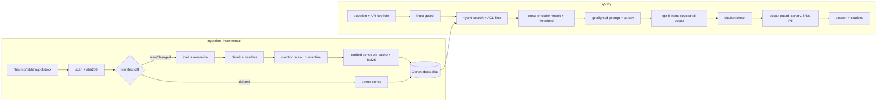

# ragkit: a production-style RAG pipeline you can learn from

A Retrieval-Augmented Generation (RAG) system over 21 documents from a fictional company,
"Lumora Labs". It's built the way production RAG services are built:

- **Incremental ingestion.** Only new, changed or deleted files are processed, and unchanged
  paragraphs are never re-embedded (content-hash manifest + embedding cache).
- **Hybrid retrieval.** Dense vectors and BM25 keyword search are fused with RRF, then
  re-ranked by a cross-encoder, with a relevance threshold that lets the system say
  "I don't know".
- **Access control.** HR-only documents are filtered out *inside the vector DB query*.
- **Defense-in-depth security** against prompt injection (direct and hidden in documents),
  system-prompt leaks, data exfiltration, PII leaks and runaway costs.
- **Grounded answers.** Structured output; every answer must cite documents it was given.
- **Evaluation.** Retrieval metrics and an adversarial attack suite that gates CI.
- **Cheap by default.** `gpt-5-nano` for answers, plus a fully free local mode for everything else.

> **Also built with LangChain:** [`langchain_app/`](langchain_app/) is the same app built with
> LangChain 1.x (LCEL, `index()` + `SQLRecordManager`, `QdrantVectorStore` hybrid mode).
> Both score the same on the eval. [langchain_app/COMPARISON.md](langchain_app/COMPARISON.md)
> compares the two stage by stage.

> New to RAG? Read [docs/LEARNING_NOTES.md](docs/LEARNING_NOTES.md) alongside the code. It
> walks through every stage, explains why each one exists, and suggests experiments.

## Architecture



## Quick start

```bash
make install                 # uv creates a Python 3.12 venv from uv.lock
cp .env.example .env         # add your OPENAI_API_KEY

# Vector DB: either Docker...
make up                      # Qdrant on localhost:6333
# ...or no Docker at all: uncomment QDRANT_PATH=var/qdrant_local in .env

make ingest                  # index data/corpus (~98 chunks, < $0.001 with OpenAI embeddings)
make ask Q="How many PTO days do I get?"
make serve                   # web UI on http://localhost:8000, use key dev-employee-key
```

### Zero-cost mode (no OpenAI key needed)

```bash
EMBEDDINGS_PROVIDER=local LLM_PROVIDER=fake MODERATION_ENABLED=false QDRANT_PATH=var/qdrant_local \
  uv run rag ask "What does ERR-4291 mean?" --debug
```

Retrieval runs fully locally with fastembed models. `LLM_PROVIDER=fake` returns the top
sentence instead of calling a model, which is handy for exploring retrieval.

## Commands

| Command | What it does |
|---|---|
| `rag ingest data/corpus [--dry-run] [--force]` | Incremental sync of a folder |
| `rag status` | Index alias, manifest, quarantined chunks, spend today |
| `rag ask "..." --role employee\|hr\|admin --debug` | Full guarded pipeline with retrieval debug |
| `rag reindex` | Blue/green rebuild into a new collection + atomic alias swap |
| `rag eval [--llm] [--judge]` | Retrieval metrics + adversarial suite (+ answer quality) |
| `rag serve` | FastAPI + web UI |
| `make demo-incremental` | Edit/delete/add files and watch only the diff get processed |

## API

All endpoints except `/health`, `/ready` and `/` need an `X-API-Key` header. Keys map to roles in `API_KEYS`.

| Method | Path | Role | Notes |
|---|---|---|---|
| POST | `/query` | any | `{"question": "...", "debug": false}` |
| POST | `/ingest/sync?dry_run=true` | admin | Incremental sync of `CORPUS_DIR` |
| POST | `/ingest/upload` | admin | multipart `file` + `acl` (public/hr), validated by magic bytes and size |
| GET | `/ingest/status` | admin | Manifest, quarantine, spend |
| GET | `/health`, `/ready` | none | Liveness / readiness (Qdrant reachable, index exists) |

OpenAPI docs: http://localhost:8000/docs

## Cost

| Item | Model | Price | This project |
|---|---|---|---|
| Answers | `gpt-5-nano` | ~$0.05 / 1M input tokens, $0.40 / 1M output | ~$0.0002 per question |
| Embeddings | `text-embedding-3-small` | ~$0.02 / 1M tokens | < $0.001 for the whole corpus, once |
| Moderation | `omni-moderation-latest` | free | n/a |
| BM25, reranker, local embeddings | fastembed (CPU) | free | n/a |

Prices change. Check https://openai.com/api/pricing and update the `*_PRICE_PER_M` settings.
`DAILY_BUDGET_USD` (default $0.50) is a hard stop enforced before every paid call.
OpenAI has no free API tier, so you need a small prepaid balance.

## Project layout

```
src/ragkit/
  config.py              all settings (env / .env), role -> ACL mapping, pipeline_version
  ingestion/             scanner, loaders, normalize, chunker, manifest, pipeline
  embeddings/            OpenAI / local / fake embedders, BM25, content-addressed cache
  store/qdrant_store.py  collections, alias swap, hybrid query
  retrieval/             hybrid search, ACL filter, rerank, threshold, recency
  generation/            prompts (spotlighting + canary), LLM client, citation validation
  guardrails/            injection detector, input/output guards, moderation, PII redaction
  api/                   FastAPI app, auth + rate limit, static UI
  observability/         JSON logs with request ids, cost ledger + budget
  service.py             the query pipeline in one readable function
  evaluation.py          eval suites
data/corpus/             21 Lumora Labs docs (md, txt, html, pdf, docx) + sidecar metadata
data/scenarios/          files used by the incremental-ingestion demo
eval/                    golden.jsonl (47 questions), adversarial.jsonl (13 attacks)
tests/                   61 offline tests (in-memory Qdrant, fake models)
docs/                    ARCHITECTURE.md, SECURITY.md, LEARNING_NOTES.md
```

## Current eval results (local embeddings, free)

```
retrieval   hit@5 1.00   MRR 0.96   recall@5 1.00   (43 answerable questions)
adversarial 13/13 attacks blocked or neutralized
```
